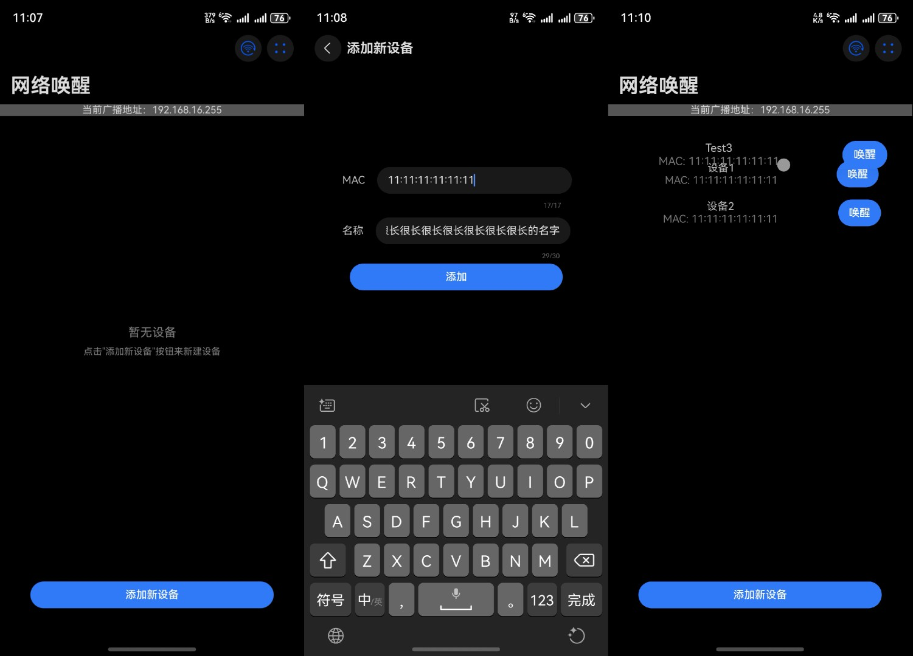
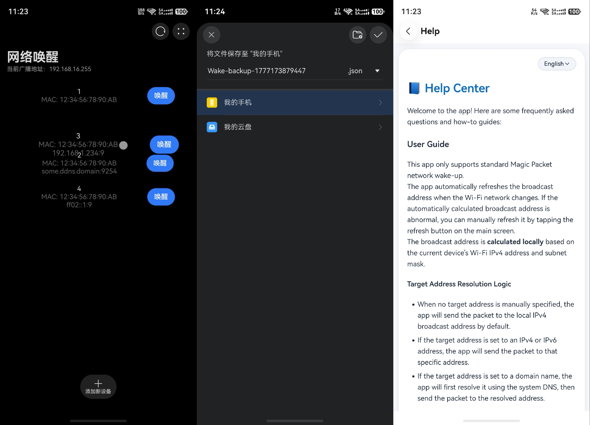
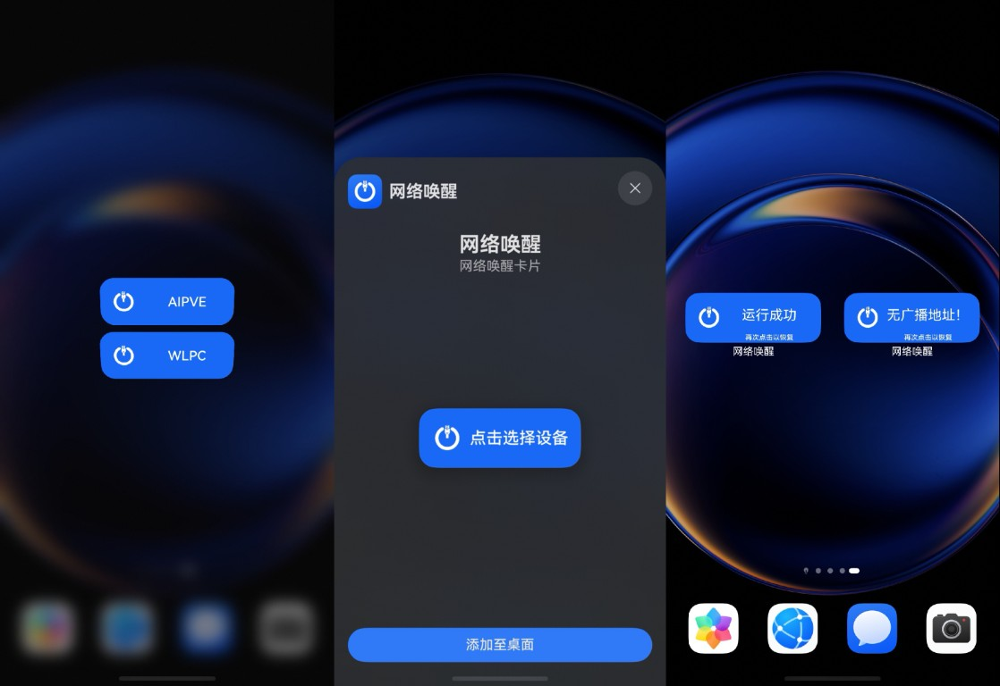
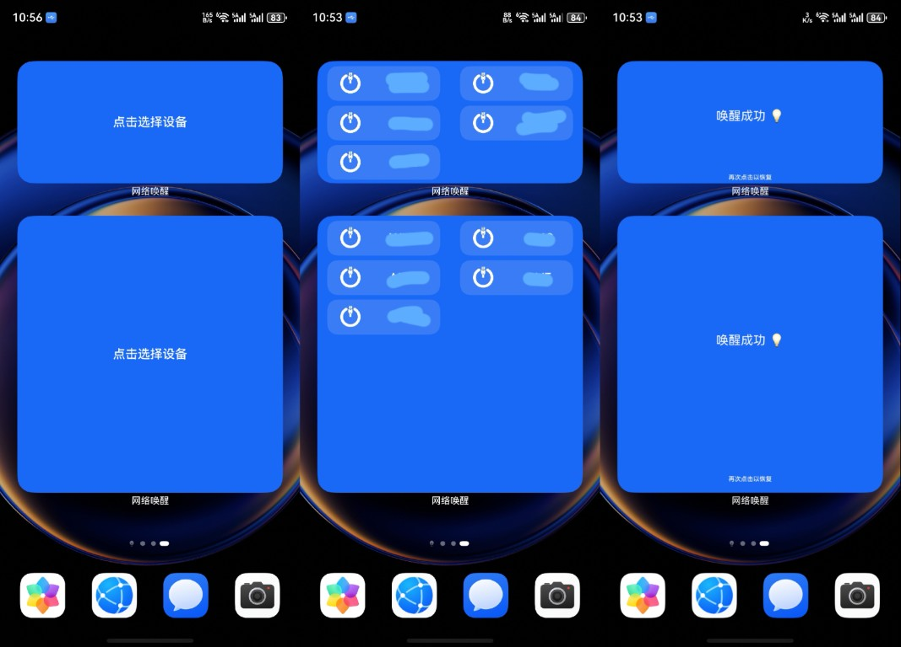

# Wake-HarmonyOS

Simple Wake-on-LAN application for HarmonyOS NEXT (5.0+).

Supports standard WoL, device import/export (as .json file) and cards.

Demo video on Mate 60 Pro: [BV1uZUVYHE2a](https://www.bilibili.com/video/BV1uZUVYHE2a/) (early version, demonstrated only WoL feature).

_Only tested on Mate 60 Pro._

## Screenshots

<picture>
  
  
  
  
</picture>
